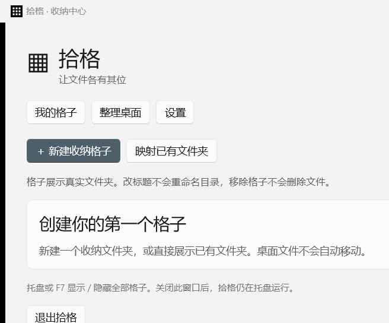

# 拾格 Shige

一个独立编写的 Windows 本地文件收纳学习项目。C# / WinUI 3，简体中文，无在线服务。

[](https://github.com/haihaihai112/shige/actions/workflows/windows.yml)

[下载 Windows x64 运行包](https://github.com/haihaihai112/shige/releases/tag/v0.1.0) · [学习指南](docs/LEARNING.md) · [验证记录](docs/VERIFICATION.md)



## 使用

解压 Windows x64 发行包，双击 `Shige.App.exe`。发行包携带 .NET 和 Windows App SDK 运行依赖；请保留完整目录。

- **新建收纳格子**：在收纳根目录下创建真实文件夹。默认根目录为 `%USERPROFILE%\ShigeFiles`。
- **映射已有文件夹**：展示文件夹，不搬动已有内容。
- 格子支持多选、框选、系统图标、双击打开、复制/剪切/粘贴、重命名、回收站删除、新建文件夹、排序与拖放。子目录交给资源管理器打开。
- 同盘拖入默认移动，跨盘默认复制；Ctrl 复制、Shift 移动，以拖放提示为准。手动排序时可在格子内部拖动图标。
- 格子可移动、缩放、锁定并保存位置。关闭窗口将其隐藏，可从收纳中心或托盘找回。
- **标题改名只改显示名称；移除格子不会删除实际目录或文件。**
- 托盘或 F7 显示/隐藏。F7 冲突时仍可使用托盘。托盘菜单提供新建、整理、撤销、设置和退出。
- **整理桌面**：选择六类目标 → 生成预览 → 取消勾选不想移动的文件 → 确认移动。新格子只为实际有文件的类别建立。支持取消剩余操作和撤销最近一批整理。
- 设置包含常规、格子、整理三页；开机启动默认关闭。

只扫描个人桌面的普通文件；公共桌面、文件夹、隐藏/系统文件、临时下载文件不整理。配置导出只包含设置、路径和布局，不包含收纳文件。

## 源码构建

环境：Windows 10 2004+ 或 Windows 11、x64、.NET 10 SDK、PowerShell 7。第一次还原需要访问 NuGet。

```powershell
pwsh -File .\scripts\Build.ps1 -Publish
# SDK 不在 PATH 时
pwsh -File .\scripts\Build.ps1 -Dotnet 'D:\tools\dotnet\dotnet.exe' -Publish
```

产物位于 `artifacts/Shige-win-x64/`。项目不依赖 Visual Studio 来执行上述命令。
构建脚本依次执行 Core 测试、Windows 平台测试和 WinUI 编译；`-Publish` 额外输出自包含程序并保留第三方许可文件。平台测试仅对自行创建的临时文件执行文件操作和回收站验证。

先用隔离环境学习，不需要使用真实桌面：

```powershell
pwsh -File .\scripts\Run-Learning.ps1 -Isolated
```

测试文件放 `artifacts/learning/desktop`；测试配置和收纳文件也在 `artifacts/learning`。独立运行实例全局限一个，切换学习环境前先从托盘退出已有实例。

## 目录与阅读顺序

| 路径 | 内容 |
|---|---|
| `src/Shige.Core` | 配置、路径检查、分类、整理事务与撤销 |
| `src/Shige.App/Program.cs`、`App.xaml` | 原生应用入口与 WinUI 元数据 |
| `src/Shige.App/AppController.cs` | 窗口和用户命令协调 |
| `src/Shige.App/BoxWindow.cs` | 文件网格、监听、选择、拖放和快捷键 |
| `src/Shige.App/OrganizeWindow.cs` | 目标选择、预览、执行与进度 |
| `src/Shige.App/Platform` | 托盘、热键、Shell 和窗口原生接口 |
| `tests/Shige.Core.Tests` | 临时目录中的真实文件行为测试 |
| `docs/LEARNING.md` | 架构与关键实现讲解 |
| `docs/VERIFICATION.md` | 已执行验证与待测场景 |

## 数据和边界

配置、日志和事务默认位于 `%LOCALAPPDATA%\Shige`；收纳文件独立保存在实际文件夹中。删除应用目录不会删除收纳文件。整理遇到重名不覆盖，撤销遇到内容变化或原位置被占用则保留现状并说明。

本版拒绝跨卷移动整个文件夹及重解析点递归操作；可改用复制并自行核对。跨卷移动带 NTFS 命名数据流的文件会拒绝，避免丢失附加数据。回收站删除仅支持可验证的本地 NTFS 固定磁盘，其余位置请使用资源管理器处理。

这是便于阅读与修改的 0.1 学习版。多屏、DPI、休眠和 Explorer 重启均有恢复代码，具体硬件组合的验证范围见验证记录。
